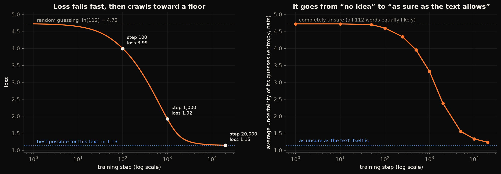
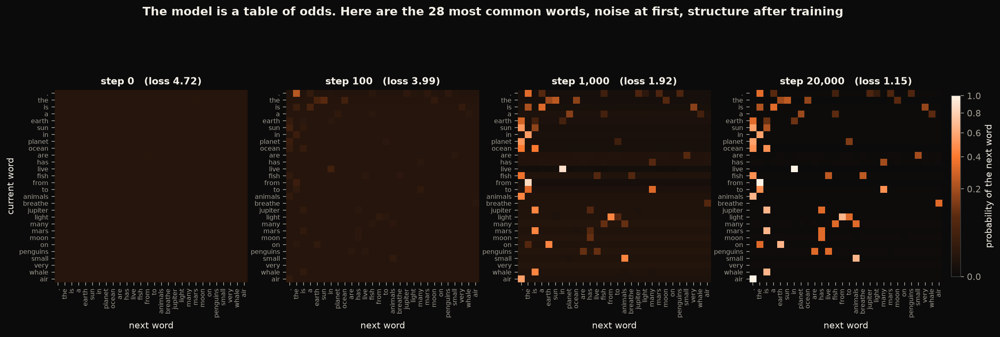
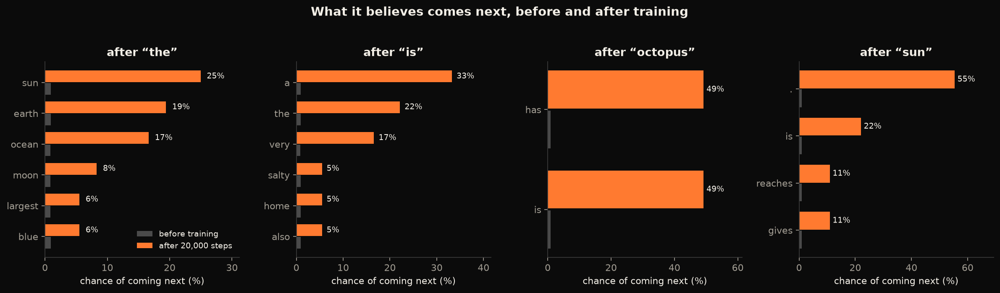
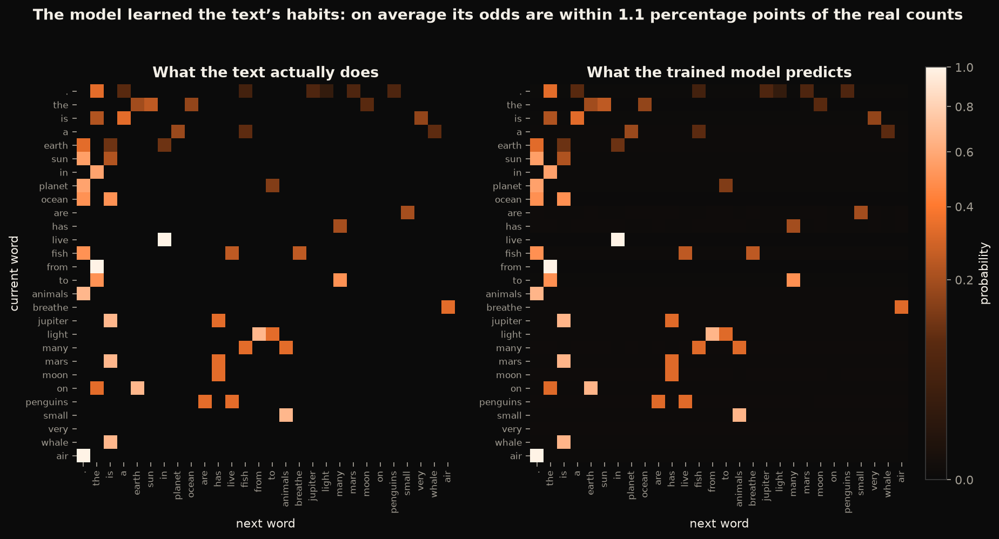
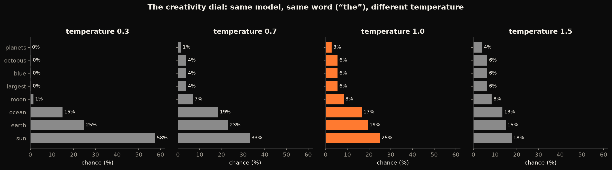
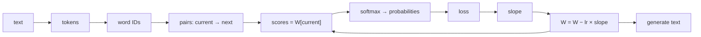

# Tiny Language Model

### How does an AI think?

That's the question I couldn't stop asking. I'm a cybersecurity student, not an ML engineer, and every video about AI made me more curious and more annoyed that I only knew it as a black box. So I did the thing I always do when I want to understand something: I built it myself, from zero.

This repo is the result. It's a next-word predictor written in **plain Python and NumPy**. No PyTorch, no TensorFlow, no "just call the API". It reads a tiny text, learns which word tends to come after which, and then writes its own sentences. It's the same core idea behind the big chat models, just about a billion times smaller and much dumber.

And that's the point. When a model this small gets things wrong, you can look at the numbers and see **exactly why**.

**So, how does an AI think?** The honest answer from what I built: it doesn't think. It predicts what's *likely* to come next, over and over. It feels like thinking because the predictions get good. Mine are not good yet, and this README explains why.

Part of a series with my other project, [Drone Link Lab](https://viktor-in-the-wire.github.io/drone-link-lab/), where I built a signed drone telemetry link from raw bytes. Same idea: build it small, understand every piece.

## What it does

- Reads text, cuts it into words (tokens) and gives each word a number
- Builds training pairs: "given this word, what came next?"
- Predicts the next word with a single table of weights (112 × 112 = 12,544 numbers)
- Turns scores into probabilities with **softmax**, and measures how wrong it is with a **loss**
- Learns with **gradient descent**: nudge the weights downhill, 20,000 times
- Generates new text by rolling a weighted dice, one word at a time

## What it looks like

Trained on two short texts I wrote, one about space and one about the ocean (324 words, 112 different ones):

```
tokens: 324 | vocab: 112 | pairs: 323
loss at start: 4.719 | loss at end: 1.146

the ocean . a day on the ocean is
the ocean is a year on earth orbits the
the earth . the closest planet made of gas
```

The loss starts at **4.719**, which is `ln(112)`, the score of a model guessing completely at random. After training it's **1.146**. So it learned *something*. The sentences are the proof of how little, and I'm keeping them in here on purpose.

## The pictures

These are the kind of charts people use to look inside a trained model, made from my model's real numbers by [`make_plots.py`](make_plots.py). Nothing here is mocked up.

### Training: loss and uncertainty



**Left:** the loss drops from 4.72 (pure guessing) to 1.15, fast at first and then it crawls. **The dotted blue line is the best any one-word model can do on this text (about 1.13).** It isn't zero, because the text itself is unsure: after `the` it really does continue with 12 different words. **Right:** same story from another angle. The model starts "equally unsure about all 112 words" and ends about as unsure as the text is.

### What the table looks like while it learns



The whole model is one table: each row is the current word, each column a possible next word, and the brightness is the chance it gives. This shows the 28 most common words. At step 0 it's a flat smear, because it knows nothing. By step 20,000 each row has a few bright cells, which are the words that actually followed it in the text.

### What it predicts, before and after



Grey is before training (about 1% for everything). Orange is after. Look at `octopus`: the text says "the octopus has eight arms" and "the octopus is very smart", so the model ends up at 49% `has` and 49% `is`. It learned exactly what it was shown.

### Is it learning anything beyond counting?



Left is just counting which word follows which in the text. Right is what the trained model predicts. They're nearly the same picture, and on average the model's odds are within 1.1 percentage points of the counts (weighted by how often each word appears). That's the honest result: **a one-word model is a very fancy counting table.** It doesn't understand anything, it memorised the habits of 324 words.

### The temperature dial



Same model, same word (`the`), only the temperature changes. At 0.3 it picks `sun` 58% of the time, which is safe and repetitive. At 1.0 it follows the real odds (25%). At 1.5 the odds flatten (18%) and weird words get a real chance. That's all "creativity" is here: how flat the dice are.

## How it works



1. **Tokenize.** Split the text into words and build a vocabulary (every different word, sorted).
2. **Make pairs.** Word 1 → word 2, word 2 → word 3, and so on. This is the whole "dataset". No labels needed, the text labels itself.
3. **Predict.** The model is one grid `W`. Row *i* holds a score for every possible next word after word *i*.
4. **Softmax.** Scores can be anything, so softmax squashes each row into probabilities that add up to 1.
5. **Loss.** Take the probability the model gave to the *correct* next word and compute `−log(p)`. Right and confident = close to 0. Confidently wrong = huge.
6. **Learn.** Work out the slope of the loss for every weight, and move each weight a small step downhill. Repeat.
7. **Generate.** Start from a word, roll a weighted dice over its row, take that word, repeat.

## Quick start

Requires Python 3.10 or newer.

```bash
# 1. create an environment and install the dependencies
#    (NumPy runs the model, matplotlib is only for the pictures)
python -m venv .venv
.venv\Scripts\activate          # Windows
# source .venv/bin/activate     # Linux / macOS
pip install -r requirements.txt

# 2. train it and generate text (takes about 15 seconds)
python lm.py

# 3. optional: export the data and redraw the pictures (about a minute)
python export_data.py           # writes the model data to docs/data/
python make_plots.py            # writes the charts to images/
```

Want to play with it? The settings are at the top of `lm.py`: `SEED`, `LEARNING_RATE`, `STEPS`. Change one at a time and watch the loss.

There's also an interactive explainer page in [`docs/`](docs/) that runs on GitHub Pages. It reads the exported data, so every number on it comes from the real model.

## Things that went wrong (the good part)

- **My training loop printed the same loss 10 times.** It was updating the weights, but I was reusing values I'd calculated *before* the loop. The model changed and nothing looked at the change. Everything that depends on the weights has to be recalculated inside the loop.
- **1,000 steps looked like it worked, but it was under-trained.** After 1,000 steps the loss was 1.923 and the model gave "octopus is" and "octopus has" only 12% each. At 20,000 steps the loss reaches 1.146 and it's at about 49% each, which is what the text actually says. The loop finishing doesn't mean the model is done.
- **One-hot encoding doesn't scale.** I first fed words in as big grids of zeros with a single 1. It works, and it's how I learned it, but on a real-sized text that grid would be gigabytes of mostly zeros. Looking up the row directly gives the **exact same loss** (1.9230406615528393 both ways after 1,000 steps) and skips all the waste.
- **A shortcut that silently gives wrong answers.** `slope[current] += d` looks right but counts a repeated word only once. `numpy.add.at` adds every occurrence. No error message either way, only a different loss: after 1,000 steps I get 1.923 with `add.at` and 3.525 with the shortcut.
- **Random seeds.** Two of my ten generated sentences picked a word that had a 0.2% chance. I thought my code was broken. It wasn't, it was just a weird roll.

## What it can't do (honest limits)

- **It only remembers one word.** After `the` it has no idea if it was talking about whales or planets. That's why it jumps between topics mid-sentence.
- **It learns what's likely, not what's true.** It can write something smooth that's flat-out false, and it has no way to know. This is the same reason big models hallucinate, just at a much smaller scale.
- **Tiny data.** 324 words isn't enough to learn much of anything. Most words appear once or twice.
- **It can't answer questions.** To answer, a model has to remember the question while it writes the answer, and one word of memory can't do that.

## Roadmap

- [x] Tokenizer, vocabulary, training pairs
- [x] Softmax, loss, gradient descent, text generation
- [x] Row lookup instead of one-hot grids (same loss, way less memory)
- [ ] Bigger real text, cleaned (lowercase, punctuation)
- [ ] Train / test split, so I can tell learning from memorizing
- [ ] 2-word context, and measure what it changes
- [ ] Temperature (the "creativity" dial) and stopping at a full stop
- [x] Plots: loss curve, heatmaps, predictions, temperature
- [x] Interactive explainer page (`docs/`)
- [ ] Data poisoning experiment (see below)

## Why a security student built this

Because if you want to attack or defend AI systems, "it's magic" isn't good enough. Once I could see that the whole model is a table of numbers shaped by its training text, a few things clicked:

- **Poisoning is easy to understand.** Change the text and you change the table. A few repeated sentences can bend what the model "believes". That's my next experiment.
- **Fluent isn't trustworthy.** A model has no concept of true or false, only likely. Anything that treats its output as fact is a risk.
- **Prompt injection makes sense.** The model can't tell instructions from data, because to it everything is just text to continue.

## Repository layout

```
tiny-language-model/
├── lm.py               tokenizer, training loop, text generation
├── export_data.py      saves the trained model as JSON for the page and the charts
├── make_plots.py       draws the charts in images/
├── images/             the charts used in this README
├── docs/               interactive explainer page (GitHub Pages) and its data
├── data/
│   ├── space.txt       training text (written by me)
│   └── ocean.txt       training text (written by me)
├── requirements.txt
├── LICENSE
└── README.md
```

## References

- [Softmax function](https://en.wikipedia.org/wiki/Softmax_function) and [cross-entropy loss](https://en.wikipedia.org/wiki/Cross-entropy)
- [NumPy documentation](https://numpy.org/doc/)

Further reading, if you want to go deeper than I did: [Andrej Karpathy's "Neural Networks: Zero to Hero"](https://karpathy.ai/zero-to-hero.html).

## Acknowledgements

Code by Viktor Grozdev. I typed and debugged every line myself. Claude helped as a teacher: it explained the concepts, gave me small exercises and reviewed my files.

## License

[MIT](LICENSE)
